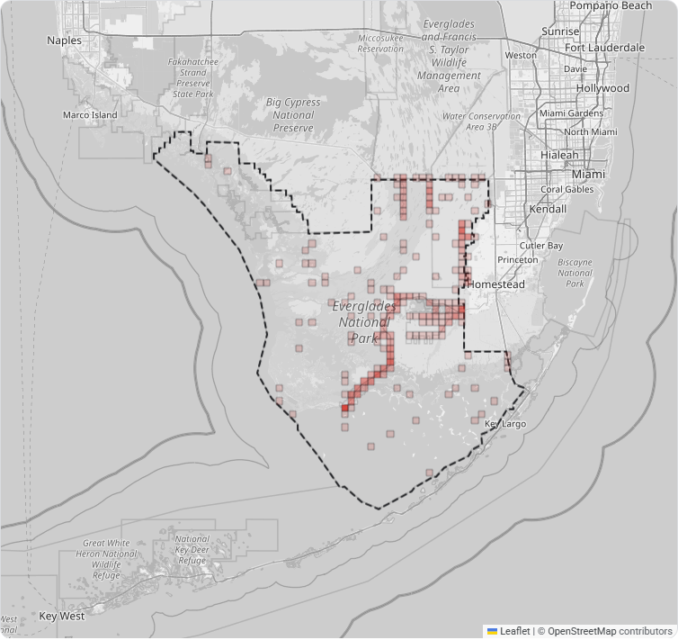
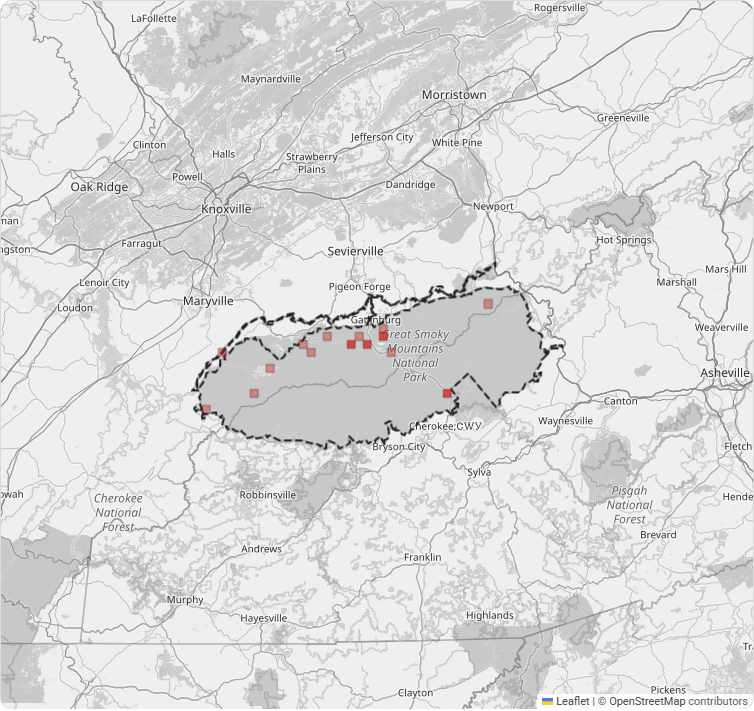
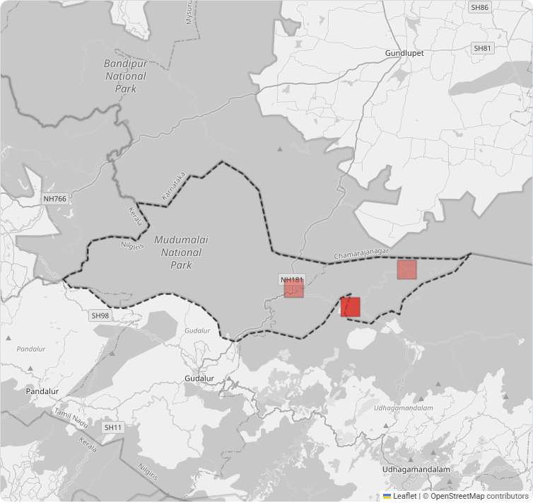

# Invasive-species hotspots in six national parks, and what peer-reviewed research reports about them

K N Thushaar Rangan, Yashas S, Amogh P A and G Ritzia

*Affiliations: to be added by the authors.*

Records and analyses are those held on 8 November 2026. The evidence base was last checked on 13 November 2026. A dashboard with the maps and papers is at <https://biodiversity-ecru.vercel.app>.

## Abstract

Park managers need to know where invasive species concentrate and what they do to native species, but the open records that could answer this are scattered, uneven in quality and seldom linked to the research on effects. We combined iNaturalist observations, GBIF specimen records, curated USGS records of non-native aquatic species and GRIIS invasive-status checklists for six national parks in India, Tanzania and the United States, and linked species to peer-reviewed papers. A species counts as invasive in a park only when GRIIS lists it as alien and invasive in the park's country and a peer-reviewed paper in our evidence base reports on it. After explicit quality rules the study held 41,415 records, of which 2,460 are records of 10 such invasive species. We set aside 1,213 records of 192 further species that GRIIS lists as invasive and for which we found no paper. Invasive records are concentrated in the Everglades, where the busiest 10% of 2 km squares hold 55% of them. They are sparse elsewhere: 2 to 7 in each Indian park, 20 in Great Smoky Mountains and none in Serengeti. Two parks had enough data for statistical tests. In Great Smoky Mountains native richness correlated positively with invasive share across 77 squares, 13 of which held invasive records (Spearman's rho = 0.35, 95% bootstrap interval 0.14 to 0.52), which is consistent with both measures being higher in accessible, disturbed and heavily visited squares. In the Everglades the number of invasive records per observation rose over 77 years (Kendall's tau = 0.53, p < 0.001), a result that survives a correction for the 4 tests we ran and that follows the mix of sources: one species supplies 82% of the invasive records, one database supplies 90%, and the park's iNaturalist records end in January 2019. Findings on effects and management come only from journal articles: 31 peer-reviewed papers published 2016 to 2026 support 21 findings and 19 management rows for 14 species, and every quotation was checked against the abstract of its paper. Classifiers on a frozen DINOv2 backbone named invasive plants correctly in 84.9% of test photos by photographers unseen in training and made no native look-alike error in 113 trials, and the MegaDetector V6 detector found 92.6% of animal photos on a held-out camera-trap sample. Invasive counts reflect recording effort as well as presence, a species without a paper in the evidence base is not recorded, the iNaturalist records of three parks end early, and the statistical estimates are confounded by effort and source.

**Keywords:** invasive alien species; hotspot mapping; citizen science; camera traps; GRIIS; iNaturalist; USGS NAS; computer vision; decision support

## 1. Introduction

Biological invasions are among the main pressures on biodiversity, and the number of alien species keeps rising with no sign of saturation (Seebens et al. 2017). In protected areas the practical questions are local. Managers want to know which invasive species are present, where they concentrate, what they do to the native species around them, and what has been tried against them elsewhere.

Open data now answers part of each question. Community platforms such as iNaturalist and the Global Biodiversity Information Facility (GBIF) hold millions of georeferenced records. The Global Register of Introduced and Invasive Species (GRIIS) lists which species are alien and invasive in each country (Pagad et al. 2018). Curated databases such as the U.S. Geological Survey's Nonindigenous Aquatic Species (NAS) database record non-native species with their source, positional accuracy and establishment status. These sources are separate, they differ in quality, and opportunistic records are relatively unstructured, with recorder activity that varies (Isaac et al. 2014). Evidence about effects sits in journals that a park manager is unlikely to search record by record.

Deep learning has also changed how images are processed. Detectors such as MegaDetector have been tested at finding humans and animals in camera-trap images against manual classification (Fennell et al. 2022), deep learning is used to detect objects such as animals, humans and vehicles and to classify species (Vélez et al. 2022), and classifiers identify species in camera-trap images (Norouzzadeh et al. 2018; Tabak et al. 2019). We test whether a frozen self-supervised vision backbone, DINOv2, can serve as the base for small classifiers of invasive plants and camera-trap animals.

We joined these ingredients for six national parks in India, Tanzania and the United States, and ask four questions of the data:

1. Where do invasive-species records concentrate in each park?
2. Which species occur in those hotspots, and what do peer-reviewed papers report about their effects on the local environment?
3. Do the records support statistical tests of an association between invader density and native richness, or of change in the invasive share over time?
4. How accurately can small classifiers on a frozen vision backbone identify invasive plants and camera-trap animals?

Our contributions are: (i) a record set drawn from four public sources under explicit, counted quality rules; (ii) hotspot maps that link each species to the papers that report on it; (iii) statistical tests that are run only when the data meets stated minimums, and that report the shortfall otherwise; and (iv) CPU-only classifiers evaluated on photographers and cameras unseen in training. Section 2 describes the data and methods, Section 3 the results, Section 4 discusses them and their limits, and Section 5 concludes.

## 2. Data and methods

### 2.1 Study areas

We chose six national parks (Table 1). Bandipur, Nagarahole and Mudumalai form a contiguous landscape in the Western Ghats of southern India. Serengeti in Tanzania is a savanna comparison. Everglades and Great Smoky Mountains in the United States add two ecosystems with dense records and many studies of invasions. Park boundaries come from OpenStreetMap (ODbL) and were checked for plausible area.

### 2.2 Data sources

**iNaturalist.** We retrieved research-grade observations inside each park's bounding box through the public API, oldest first, and stored at most 8,000 per park. Three parks reached that limit, so their iNaturalist records stop early: the Everglades in January 2019, Great Smoky Mountains in February 2019 and Serengeti in March 2024. Photos were used only when their licence allowed it.

**GBIF.** We retrieved preserved specimens only. A specimen traces to a collection in a museum or herbarium. Human observations, machine observations, material samples and records of unspecified origin do not, and GBIF also republishes iNaturalist observations, which would be counted twice. An earlier version of our query took every kind of record, and we removed the 731 of the 9,751 GBIF records it had stored that were not specimens.

**USGS NAS.** For the two US parks we retrieved NAS occurrence records for the counties that contain each park (three in Florida, five across Tennessee and North Carolina), because the API has no bounding-box search. Each record carries a source type (literature, specimen or personal communication), a coordinate accuracy class (accurate, approximate, centroid) and an establishment status.

**GRIIS.** We used the national checklists for India, Tanzania and the contiguous United States, which give each species' establishment means and whether it is invasive.

**Caltech Camera Traps.** One thousand photos from this public set (Beery et al. 2018), distributed through LILA BC, served to test the detector.

### 2.3 Record quality rules

Every record passes the same rules, and each refusal is counted by reason. A record must identify a species, carry a day-precision date that is not in the future, and have a position that is not deliberately obscured and is accurate to 2 km or better. Records with unknown accuracy are accepted. Captive or cultivated records are excluded, as are NAS records of failed introductions. A record must fall inside the park boundary, which we test with a bounding-box check followed by an exact polygon test. Duplicate records are removed. Species names are matched to the GBIF backbone taxonomy. A record of an invasive species is stored only when a peer-reviewed paper in the evidence base reports on that species (Section 2.7). When we applied this rule to the records already stored, we removed 1,213 records of 192 species.

### 2.4 Invasive status of records

We classify a record by its species and the park's country. A record is *invasive* when GRIIS lists the species as alien and invasive for that country and the evidence base holds a peer-reviewed paper on the species. It is *introduced* when GRIIS lists it as alien but not invasive. Species that GRIIS records as both native and alien in the same country (for example the chital, *Axis axis*) are excluded from the invasive class, because a country-level list cannot say which applies at a park.

### 2.5 Hotspot mapping

We grouped invasive records into square cells 2 km on a side. A cell is sized from the park's latitude, so that it is as wide as it is tall on the ground. We summarise concentration as the share of a park's invasive records that fall in its busiest 10% of occupied cells, and we report the number of records in the busiest cell. Maps shade cells by record count in five levels on a square-root scale, which keeps one very busy cell from reducing every other cell to the lightest shade.

### 2.6 Statistical analysis of impact

The analysis has two layers beyond the published evidence (Section 2.7). The first asks whether native richness is lower where invaders are denser. For each 0.05-degree cell (about 5 km) we computed the share of records that are invasive and the native species richness rarefied to a common sample of 10 native records (Hurlbert 1971), which removes the dependence of richness on how often observers visited a cell. We then computed Spearman's rank correlation with a 95% percentile bootstrap interval from 2,000 resamples (Efron 1979). The second layer asks whether the invasive share of records is changing. We computed yearly invasive and native records per observation and tested each series with the Mann-Kendall test (Mann 1945) and the Theil-Sen slope (Sen 1968). Our implementations agree with SciPy (Virtanen et al. 2020), exactly for Kendall's tau and the slope and within 0.03 for the p-value. In this study 4 tests met their minimums and were run: one correlation for each of the two parks that met the co-occurrence minimum, and one test for each of the two series in the one park that met the trend minimum. We report unadjusted p-values beside a Bonferroni threshold of 0.0125. The two series of a park share their denominator and are correlated, so the threshold is conservative.

Each layer runs only above a minimum amount of data. The co-occurrence layer needs at least 20 cells with 10 or more native records, of which at least 5 also hold invasive records. The trend layer needs at least 6 years with 15 or more observations each and at least 30 invasive records in the park. Below these minimums the output is the shortfall and nothing else.

### 2.7 Evidence from published research

Findings on the effects of invasive species and on management options come from peer-reviewed journal articles only. We did not use news, reports, web pages, species profiles, fact sheets or preprints. A paper entered the evidence base when it was a journal article with a DOI, published in 2016 or later, whose Crossref and OpenAlex records matched its title, journal, year and first author and showed no retraction. Each row of the evidence base restates the result of one paper, with the setting of the study (place, sample and period) and its design: controlled experiment, field study, review of studies or model projection. Each row is supported by verbatim quotations from the abstract of the paper, and a program confirmed that every quotation appears there, ignoring typography only. We made no ratings of our own, such as how well a method works or what it costs, because no paper states them in general. Null and negative results were recorded alongside positive ones. A species is reported with findings only when a paper backs it.

### 2.8 Computer-vision models

The detector is the MIT-licensed variant of MegaDetector V6 (YOLOv9-c), run on an ordinary CPU. We checked our conversion of the model against the reference implementation on 60 photos and evaluated the detector on 1,000 Caltech Camera Traps photos (720 with animals, 30 with vehicles, 250 verified empty) against human-drawn boxes.

The classifiers share one frozen DINOv2 ViT-S/14 backbone. Each photo is embedded once, and a logistic-regression head is trained on the 768-number embedding. We chose the regularisation strength by validation log-loss and calibrated probabilities by temperature scaling, which divides the scores by one number fitted on validation data. Below a threshold the classifier answers "unknown". Each threshold was fixed on validation data before the test set was scored: for the plant classifier, the lowest value at which each kind of non-target plant was called invasive no more than 5% of the time, and for the animal classifier the lowest value at which answers were at least 95% correct. The plant classifier has 15 classes: ten invasives, four native look-alikes drawn from iNaturalist's identification confusions and recorded as native to India, and a class of random other plants. It was trained on 1,407 and tested on 469 CC-licensed photos, with the split made by observer so that no photographer appears on both sides. The animal classifier has 13 North American classes cut from Caltech Camera Traps boxes (1,732 training and 565 test crops), split by camera location. We report 95% Wilson score intervals (Wilson 1927).

### 2.9 Data handling

We kept only detection boxes and source links for images, never the images. People detected in photos were neither cropped nor classified.

## 3. Results

All counts in this section are from the study database on 8 November 2026.

### 3.1 Data assembled

The database held 41,415 records that passed the quality rules (Table 1): 28,143 from iNaturalist, 9,020 from GBIF and 4,252 from the USGS NAS database.

**Table 1.** Records that passed the quality rules, by park and source.

<!-- table:records -->
| Park | Country | Area (km2) | iNaturalist | GBIF | USGS NAS | Records |
|---|---|---:|---:|---:|---:|---:|
| Bandipur | IN | 949 | 686 | 204 | - | 890 |
| Nagarahole | IN | 680 | 1,433 | 7 | - | 1,440 |
| Mudumalai | IN | 336 | 1,401 | 80 | - | 1,481 |
| Serengeti | TZ | 12,947 | 8,290 | 846 | - | 9,136 |
| Everglades | US | 6,237 | 8,169 | 3,432 | 4,198 | 15,799 |
| Great Smoky Mountains | US | 2,107 | 8,164 | 4,451 | 54 | 12,669 |
| **Total** |  |  | 28,143 | 9,020 | 4,252 | 41,415 |
<!-- /table -->

Most fetched records were refused. Of the 86,886 iNaturalist records fetched, 32% were kept, against 5% of 184,877 GBIF records. The GBIF count includes early runs made before we limited the query to specimens. The most complete USGS scan read 20,557 records and set 15,879 of them aside (Table 2). The largest reasons were, for iNaturalist, outside the park boundary (23,910), position too imprecise (16,662) and position deliberately obscured (16,034); for GBIF, outside the park boundary (58,365), not identified to a species (32,757) and no full date (29,724); and for USGS, outside the park boundary (13,413) and position too imprecise (2,424).

**Table 2.** Records refused, by reason and source. USGS figures come from the most complete single scan of each park's counties.

<!-- table:refused -->
| Reason | iNaturalist | GBIF specimens | USGS NAS |
|---|---:|---:|---:|
| outside zone | 23,910 | 58,365 | 13,413 |
| imprecise location | 16,662 | 25,917 | 2,424 |
| not species level | 250 | 32,757 | 0 |
| no date | 0 | 29,724 | 6 |
| obscured location | 16,034 | 977 | 0 |
| not established | 0 | 0 | 36 |
<!-- /table -->

### 3.2 Invasive records

Invasive records are a small share of all records in every park except the Everglades, where they make up 15% (Table 3). USGS supplies 90% of the Everglades invasive records. Serengeti has none.

**Table 3.** Invasive records and invasive species by park.

<!-- table:invasive -->
| Park | Records | Invasive records | Share | Invasive species |
|---|---:|---:|---:|---:|
| Bandipur | 890 | 2 | 0.2% | 1 |
| Nagarahole | 1,440 | 2 | 0.1% | 2 |
| Mudumalai | 1,481 | 7 | 0.5% | 3 |
| Serengeti | 9,136 | 0 | 0.0% | 0 |
| Everglades | 15,799 | 2,429 | 15.4% | 4 |
| Great Smoky Mountains | 12,669 | 20 | 0.2% | 4 |
<!-- /table -->

The most recorded invasive species differ sharply between parks (Table 4). In the Everglades, *Python bivittatus* (Burmese Python) makes up 82% of the invasive records. In the three Indian parks no species has more than 3 records. *Lantana camara* and *Senna spectabilis* are both described as invaders of Indian forests (Negi et al. 2019; Bargavi et al. 2025). Across the three parks the study holds 6 records of the first and no records of the second.

**Table 4.** The five most recorded invasive species in each park.

<!-- table:top_species -->
| Park | Species | Records | Years |
|---|---|---:|---|
| Bandipur | *Lantana camara* (common lantana) | 2 | 2010 to 2025 |
| Nagarahole | *Chromolaena odorata* (Siam weed) | 1 | 2024 |
| Nagarahole | *Lantana camara* (common lantana) | 1 | 2022 |
| Mudumalai | *Chromolaena odorata* (Siam weed) | 3 | 2015 to 2024 |
| Mudumalai | *Lantana camara* (common lantana) | 3 | 2024 |
| Mudumalai | *Parthenium hysterophorus* (Santa Maria feverfew) | 1 | 2024 |
| Everglades | *Python bivittatus* (Burmese Python) | 1,993 | 1979 to 2026 |
| Everglades | *Osteopilus septentrionalis* (Cuban Tree Frog) | 420 | 1950 to 2023 |
| Everglades | *Schinus terebinthifolia* (Brazilian pepper) | 12 | 1964 to 2019 |
| Everglades | *Melaleuca quinquenervia* (Broad-leaved paperbark) | 4 | 1964 to 2018 |
| Great Smoky Mountains | *Adelges tsugae* (Hemlock Woolly Adelgid) | 11 | 2005 to 2018 |
| Great Smoky Mountains | *Salmo trutta* (Brown Trout) | 5 | 2018 to 2019 |
| Great Smoky Mountains | *Microstegium vimineum* (Japanese stiltgrass) | 3 | 2015 to 2018 |
| Great Smoky Mountains | *Osteopilus septentrionalis* (Cuban Tree Frog) | 1 | 2013 |
<!-- /table -->

### 3.3 Hotspots

Only the Everglades has enough invasive records for concentration to carry much meaning (Table 5). There the busiest 10% of occupied squares hold 55% of the park's invasive records, and the busiest single square (2 km across) holds 215 of the 2,429 records (Figure 1). The Indian parks hold 2 to 7 invasive records each and Serengeti holds none. In Great Smoky Mountains, 20 invasive records fall in 15 squares, 11 of which hold one record.

**Table 5.** Concentration of invasive records in squares 2 km on a side.

<!-- table:concentration -->
| Park | Invasive records | Occupied cells | Busiest cell | Share in busiest 10% of cells | Cells with one record |
|---|---:|---:|---:|---:|---:|
| Bandipur | 2 | 1 | 2 | 100% | 0 |
| Nagarahole | 2 | 2 | 1 | 50% | 2 |
| Mudumalai | 7 | 3 | 5 | 71% | 2 |
| Everglades | 2,429 | 186 | 215 | 55% | 82 |
| Great Smoky Mountains | 20 | 15 | 3 | 25% | 11 |
<!-- /table -->

### 3.4 Whether the data supports the statistical tests

Two parks reached the minimum data for at least one statistic (Table 6). We report each result with its interval or p-value, and compare the p-values with the Bonferroni threshold of 0.0125 for 4 tests.

*Co-occurrence.* In Great Smoky Mountains, native species richness was positively correlated with the invasive share of records across 77 squares, 13 of which held invasive records (Spearman's rho = 0.35, 95% bootstrap interval 0.14 to 0.52), and the interval excludes zero. The direction is opposite to a reduction of native richness by invaders. In the Everglades the correlation across 58 squares, 39 of which held invasive records, was also positive and its interval included zero (rho = 0.16, -0.08 to 0.40).

*Trend.* Only the Everglades held the 30 invasive records the trend test needs. In the Everglades (77 years with data, 1925 to 2026), the number of invasive records per observation rose (Kendall's tau = 0.53, p < 0.001, Theil-Sen slope +0.0015 per year) and the number of native records per observation fell (tau = -0.59, p < 0.001). Both p-values are below the Bonferroni threshold of 0.0125. The two series share a denominator, so a rise in the invasive share leaves less room for the native share, and the second result adds little to the first. No other park held more than 20 invasive records, so the trend test did not run for them.

**Table 6.** Readiness of each park for the statistical tests. "Ok" means the minimum data was met and a result was computed.

<!-- table:analysis -->
| Park | Co-occurrence | Usable cells | Trend | Invasive records | Usable years |
|---|---|---|---|---|---|
| Bandipur | insufficient | 14 (20 needed) | insufficient | 2 (30 needed) | 14 (6 needed) |
| Nagarahole | insufficient | 19 (20 needed) | insufficient | 2 (30 needed) | 16 (6 needed) |
| Mudumalai | insufficient | 9 (20 needed) | insufficient | 7 (30 needed) | 16 (6 needed) |
| Serengeti | insufficient | 129 (20 needed) | insufficient | 0 (30 needed) | 35 (6 needed) |
| Everglades | ok | 58 (20 needed) | ok | 2,429 (30 needed) | 77 (6 needed) |
| Great Smoky Mountains | ok | 77 (20 needed) | insufficient | 20 (30 needed) | 27 (6 needed) |
<!-- /table -->

### 3.5 Published evidence on the species

The evidence base holds 21 findings (10 field studies, 6 controlled experiments, 4 reviews and 1 model projection) and 19 management rows (9 controlled experiments, 5 field studies and 5 reviews), supported by 84 quotations from 31 papers in 28 journals, published 2016 to 2026. They cover 14 species (Table 7). All 10 invasive species recorded in the parks on 8 November 2026 are among them, and the other 4 have no record in a park.

**Table 7.** Species with at least one peer-reviewed paper in the evidence base. Study designs count the findings and management rows of each species.

<!-- table:evidence -->
| Species | Papers | Findings | Management rows | Study designs of the rows |
|---|---:|---:|---:|---|
| *Python bivittatus* | 5 | 4 | 3 | 4 field studies, 2 reviews and 1 controlled experiment |
| *Adelges tsugae* | 4 | 2 | 3 | 2 field studies, 1 model projection, 1 review and 1 controlled experiment |
| *Lantana camara* | 3 | 3 | 2 | 3 field studies and 2 reviews |
| *Microstegium vimineum* | 3 | 2 | 2 | 4 controlled experiments |
| *Prosopis juliflora* | 3 | 2 | 1 | 2 controlled experiments and 1 review |
| *Chromolaena odorata* | 2 | 2 | 1 | 3 field studies |
| *Lygodium microphyllum* | 2 | 0 | 2 | 1 controlled experiment and 1 field study |
| *Parthenium hysterophorus* | 2 | 1 | 1 | 2 controlled experiments |
| *Senna spectabilis* | 2 | 2 | 1 | 2 reviews and 1 field study |
| *Melaleuca quinquenervia* | 1 | 0 | 1 | 1 controlled experiment |
| *Osteopilus septentrionalis* | 1 | 1 | 0 | 1 controlled experiment |
| *Pueraria montana* | 1 | 1 | 0 | 1 field study |
| *Salmo trutta* | 1 | 1 | 1 | 2 controlled experiments |
| *Schinus terebinthifolia* | 1 | 0 | 1 | 1 review |
<!-- /table -->

The papers describe a range of effects and of results. In the Everglades, mammal declines have been linked to the spread of the Burmese python (Willson 2017; Hoyer et al. 2017). In India, a review reports that *Lantana camara* has invaded vast tracts of forest and has potentially altered biodiversity, landscape ecology and ecosystem services (Negi et al. 2019), and a study in central India found lower tree species richness in invaded sites (Lone et al. 2025). Management results include null findings, for example that scent lures did not raise python detections (Miller et al. 2025) and that short-term clearing of *Lantana* in a Ugandan rainforest did not promote tree establishment (Barahukwa et al. 2023). A four-year randomised experiment in the Banni grasslands of Gujarat found that mechanical removal of *Prosopis juliflora* tripled native herb richness while lopping did not differ from the control (Nerlekar et al. 2021). Each row states the setting of its study, and several come from other regions than the parks.

### 3.6 Model performance

**Detector.** On 1,000 Caltech Camera Traps photos, MegaDetector found 92.6% of animal photos at a confidence threshold of 0.2, and 93.2% of the photos it flagged contained an animal. It flagged 17.5% of verified-empty photos, an upper bound on its false-alarm rate because many of those frames show partial or close-up animals that the label missed. Our converted model matched the reference implementation on 60 photos with zero box or confidence difference.

**Invasive-plant classifier.** On 469 test photos by photographers absent from training, top-1 accuracy over 15 classes was 89.3% (majority-class baseline 19%). At the deployed threshold of 0.76 the classifier named 81.2% of photos and was right on 96.6% of those. It named 84.9% of invasive-species photos correctly (225 of 265; 95% interval 80.1 to 88.7%). No native look-alike was called invasive in 113 photos (95% interval 0 to 3.3%), and 6 of 91 random other plants were (6.6%; 3.1 to 13.7%), above the 5% target.

**Camera-trap animal classifier.** On 16 camera locations absent from training, top-1 accuracy over 13 North American classes was 77.2% (baseline 11%), against 81.6% when the same cameras appeared on both sides. At the deployed threshold of 0.77 it named 59% of crops and was right on 98.5% of those.

## 4. Discussion

**The source shapes the picture.** The Everglades share of invasive records is 15%, and USGS supplies 90% of those records. The USGS database records non-native aquatic species and the reptiles and amphibians in its scope. Of the 8,294 Burmese python records it holds for the three Everglades counties (queried 13 November 2026), 7,531 are classed as derived from literature and 760 as specimens, so one report can contribute many records. A park's invasive share is therefore comparable with another park's only when both are drawn from the same kind of source. The share also counts only the 10 species that the evidence base covers, so it is lower than the share of records of every species GRIIS lists as invasive. Among the other five parks the invasive share ranged from 0.0% in Serengeti to 0.5% in Mudumalai.

**Three parks lack recent iNaturalist records.** We read iNaturalist oldest first and stored at most 8,000 records per park. The Everglades, Great Smoky Mountains and Serengeti reached that limit, so their iNaturalist records end in January 2019, February 2019 and March 2024. For these parks the maps and counts describe the earlier years better than the recent ones, and a recent record is measured against a smaller and different set of records than an earlier one. The three Indian parks are below the limit, and their iNaturalist records run to at least October 2026.

**Conspicuous weeds are under-recorded.** *Lantana camara* is described as having invaded vast tracts of Indian forest and pasture (Negi et al. 2019), and *Senna spectabilis* as a widespread invader in India (Bargavi et al. 2025). The three Indian parks hold 6 records of the first and no records of the second. Observers may photograph flowers and animals more often than common weeds, and community records vary with recorder activity (Isaac et al. 2014). We did not test whether this explains the few records of these weeds. Counts from these sources describe where species were recorded, and they say little about how much ground a species covers. Any use of the hotspot maps for planning should take recording effort into account. In the Everglades, effort is itself uneven. At 2 km the shaded squares form lines across the park (Figure 1), which is consistent with recording that follows roads, trails and survey routes. We did not test this.

**The statistical results reflect where people go and which sources dominate.** The positive correlation in Great Smoky Mountains runs against what studies of invader effects would lead one to expect, for example lower richness in invaded forest (Lone et al. 2025). It rests on 20 invasive records in 13 squares. Native richness at a fixed sample size is highest in well-visited, varied squares, so both measures plausibly rise with access, disturbance and habitat variety. The correlation cannot separate those influences from an effect of invaders, and we did not test them. We read it as a warning that raw co-occurrence in community data can point either way, and as no evidence that invaders raise or lower native richness.

The Everglades trend is the clearest statistical result and the least informative about invaders. Its p-value is far below the Bonferroni threshold of 0.0125, and the records offer three reasons for a rise that involves no change in invasion. First, one species and one source dominate: *Python bivittatus* makes up 82% of the invasive records and USGS supplies 90%. Second, the mix of sources changed. USGS supplied 471 of the 650 invasive records dated up to 2009 and all 835 dated 2020 or later. Across all Everglades records, USGS supplied 23%, 17% and 99% in the periods up to 2009, 2010 to 2019 and 2020 on, and iNaturalist supplied 11%, 83% and 0%. Third, the invasive share of all records was 13%, 10% and 55% in those periods, so the rise sits in the period for which the study holds no iNaturalist records. The records cannot separate a real spread of invaders from a change in who recorded what, and a rise in recorded presence says nothing about abundance. The fall in native records per observation partly mirrors the rise (Section 3.4). The tests report nothing for the parks below the minimums. For the two parks above them, the results mostly show the limits of record-based inference and give little information about effects of invaders.

**The evidence base decides which species appear.** A species is recorded as invasive only when a peer-reviewed paper in the evidence base reports on it, so every invasive species in the study has papers behind it and the study can state what they report. The cost is coverage. Applying the rule removed 1,213 records of 192 species that GRIIS lists as invasive, 959 of them in the Everglades and 205 in Great Smoky Mountains, so the maps show a narrower picture than the GRIIS lists, and a species absent from them may still be spreading. The evidence base covers 14 species, and 4 of them have no record in a park. The papers themselves vary in strength. The 21 findings rest on 10 field studies, 6 controlled experiments, 4 reviews and 1 model projection, and only the controlled experiments and the reviews support general statements. Several studies took place in other regions, and a manager reading a result should read the setting stated beside it.

**The classifiers are accurate on their test sets and untested on ranger photos.** The plant classifier names invasive species correctly in about 85% of test photos and made no look-alike errors in 113 trials. On the test photos taken in India it named 88.1% of invasives correctly and called none of 120 non-target plants invasive. Its training photos are mostly naturalist close-ups, and the snapshots a ranger would take from a distance, in shade or of whole thickets follow another distribution that we have not measured. The animal classifier covers North American species and demonstrates transfer to unseen cameras (a 4.4 point cost) without covering Indian or African fauna. Outputs below a calibrated threshold return "unknown".

**Limitations.** Invasive status comes from country-level lists, which cannot say whether a species is invasive at a particular park. Records reflect observer effort, and we rarefy richness and limit analyses to minimum data but do not model effort explicitly. Three parks lack recent iNaturalist records (above). The study is a snapshot of records that keep accumulating, and later data will change the numbers. We have no abundance data and no live camera feed: the detector runs over archived images.

## 5. Conclusion

Four public sources and country checklists can be combined for six national parks on three continents, filtered by counted quality rules, and used to show where invasive records concentrate together with what peer-reviewed research reports about each species. The study records only species that a paper backs, which leaves 2,460 invasive records of 10 species and sets aside 1,213 records of 192 more. Statistical estimates are computable for two parks. They are confounded by recording effort, by one dominant species and source in the Everglades, and by iNaturalist records that end early in three parks, and we do not read any of them as an effect of invaders. The first needs are a wider evidence base, so that more of the species GRIIS lists can be recorded, and iNaturalist records for the years after the limit in the three parks. The next steps are a model of recording effort that can separate access from invasion, more field photos for the plant classifier, local labelled camera-trap data, and peer-reviewed studies of the species most recorded in the Indian parks.

## 6. Data availability and acknowledgements

The code, the evidence base and this paper are at <https://github.com/tfthushaar/biodiversity> under the Apache-2.0 licence, and the maps and papers are at <https://biodiversity-ecru.vercel.app>. The figures and tables in this paper were generated from the study database as it stood on 8 November 2026, and the summary is stored in the repository. The dashboard reads the same database, which keeps growing, so its counts will differ from those here as records are added.

We thank the iNaturalist community, GBIF and its publishers, the GRIIS contributors, OpenStreetMap contributors, the Labeled Information Library of Alexandria: Biology and Conservation (LILA BC) and Microsoft's AI for Good Lab, whose MegaDetector weights we used under the MIT licence. The U.S. Geological Survey Nonindigenous Aquatic Species Database is cited as: U.S. Geological Survey, Nonindigenous Aquatic Species Database, Gainesville, Florida, accessed in October and November 2026. The database requests that authors contact its team before publication, and we have not yet done so.

## References

Beery, S., Van Horn, G. and Perona, P. (2018) Recognition in Terra Incognita. Lecture Notes in Computer Science. doi:10.1007/978-3-030-01270-0_28

Efron, B. (1979) Bootstrap Methods: Another Look at the Jackknife. The Annals of Statistics 7(1): 1-26. doi:10.1214/aos/1176344552

Fennell, M., Beirne, C. and Burton, A.C. (2022) Use of object detection in camera trap image identification: Assessing a method to rapidly and accurately classify human and animal detections for research and application in recreation ecology. Global Ecology and Conservation 35: e02104. doi:10.1016/j.gecco.2022.e02104

Hurlbert, S.H. (1971) The Nonconcept of Species Diversity: A Critique and Alternative Parameters. Ecology 52(4): 577-586. doi:10.2307/1934145

Isaac, N.J.B., van Strien, A.J., August, T.A., de Zeeuw, M.P. and Roy, D.B. (2014) Statistics for citizen science: extracting signals of change from noisy ecological data. Methods in Ecology and Evolution 5(10): 1052-1060. doi:10.1111/2041-210X.12254

Mann, H.B. (1945) Nonparametric Tests Against Trend. Econometrica 13(3). doi:10.2307/1907187

Norouzzadeh, M.S., Nguyen, A., Kosmala, M., Swanson, A., Palmer, M.S., Packer, C. et al. (2018) Automatically identifying, counting, and describing wild animals in camera-trap images with deep learning. Proceedings of the National Academy of Sciences 115(25). doi:10.1073/pnas.1719367115

Pagad, S., Genovesi, P., Carnevali, L., Schigel, D. and McGeoch, M.A. (2018) Introducing the Global Register of Introduced and Invasive Species. Scientific Data 5: 170202. doi:10.1038/sdata.2017.202

Seebens, H., Blackburn, T.M., Dyer, E.E., Genovesi, P., Hulme, P.E., Jeschke, J.M. et al. (2017) No saturation in the accumulation of alien species worldwide. Nature Communications 8: 14435. doi:10.1038/ncomms14435

Sen, P.K. (1968) Estimates of the Regression Coefficient Based on Kendall's Tau. Journal of the American Statistical Association 63(324): 1379-1389. doi:10.1080/01621459.1968.10480934

Tabak, M.A., Norouzzadeh, M.S., Wolfson, D.W., Sweeney, S.J., Vercauteren, K.C., Snow, N.P. et al. (2019) Machine learning to classify animal species in camera trap images: Applications in ecology. Methods in Ecology and Evolution 10(4): 585-590. doi:10.1111/2041-210X.13120

Vélez, J., McShea, W., Shamon, H., Castiblanco‐Camacho, P.J., Tabak, M.A., Chalmers, C. et al. (2022) An evaluation of platforms for processing camera‐trap data using artificial intelligence. Methods in Ecology and Evolution 14(2): 459-477. doi:10.1111/2041-210x.14044

Virtanen, P., Gommers, R., Oliphant, T.E., Haberland, M., Reddy, T., Cournapeau, D. et al. (2020) SciPy 1.0: fundamental algorithms for scientific computing in Python. Nature Methods 17(3): 261-272. doi:10.1038/s41592-019-0686-2

Wilson, E.B. (1927) Probable Inference, the Law of Succession, and Statistical Inference. Journal of the American Statistical Association 22(158): 209-212. doi:10.1080/01621459.1927.10502953

### Data, software and models

These were used by the study. None of them is cited as evidence about a species.

GBIF.org (2026) GBIF Occurrence Data. https://www.gbif.org

iNaturalist contributors (2026) iNaturalist research-grade observations. https://www.inaturalist.org

LILA BC (2026) Labeled Information Library of Alexandria: Biology and Conservation. https://lila.science

Meta AI Research (2023) DINOv2: model weights and code. https://github.com/facebookresearch/dinov2

Miao, Z., Hernandez, A., Vargas, L.F., Chacon, I.D., Ruiz, D. et al. (2025) Pytorch-Wildlife model weights (MegaDetector V6). Zenodo. https://doi.org/10.5281/zenodo.15398270

OpenStreetMap contributors (2026) OpenStreetMap, licensed under the Open Database Licence. https://www.openstreetmap.org

U.S. Geological Survey (2026) Nonindigenous Aquatic Species Database. Gainesville, Florida. https://nas.er.usgs.gov

### Papers in the evidence base

Each paper below supports at least one finding or management row, and each quotation from it was checked against its abstract.

Abdulahi, M.M., Abdulkerim Ute, J. and Regasa, T. (2017) Prosopis juliflora L: distribution, impacts and available control methods in Ethiopia. Tropical and Subtropical Agroecosystems 20. doi:10.56369/tsaes.2260

Aquino-Thomas, J., Crees, L., Miles, M. et al. (2025) Improving Mass-Rearing Techniques for Releases of Floracarus perrepae, a Biological Control Agent for Old World Climbing Fern (Lygodium microphyllum). Insects 16: 135. doi:10.3390/insects16020135

Barahukwa, A., Chapman, C.A., Namaganda, M. et al. (2023) The effects of the invasive species, Lantana camara, on regeneration of an African rainforest. African Journal of Ecology 61: 451-460. doi:10.1111/aje.13133

Bargavi, S., Baranidharan, K., Tilak, M. et al. (2025) Senna spectabilis (DC.) H. S. Irwin & Barneby invasion in India: Impacts, challenges and management - A review. Plant Science Today. doi:10.14719/pst.7138

Belgeri, A., Bajwa, A.A., Shabbir, A. et al. (2020) Managing an Invasive Weed Species, Parthenium hysterophorus, with Suppressive Plant Species in Australian Grasslands. Plants 9: 1587. doi:10.3390/plants9111587

Bibi, S., Bibi, A., Al-Ghouti, M.A. et al. (2023) Allelopathic Effects of the Invasive Prosopis juliflora (Sw.) DC. on Native Plants: Perspectives toward Agrosystems. Agronomy 13: 590. doi:10.3390/agronomy13020590

Brewer, J.S. (2026) Restoration of an oak woodland invaded by Microstegium vimineum with and without herbicide control of the invader. Restoration Ecology 34: e70322. doi:10.1111/rec.70322

Fox, D.J., Forbes, G. and Edge, C.B. (2026) Impact of imidacloprid-based chemical control for hemlock woolly adelgid (Adelges tsugae) on the eastern red-backed salamander (Plethodon cinereus). Canadian Journal of Forest Research 56: 1-11. doi:10.1139/cjfr-2025-0281

Guzy, J.C., Falk, B.G., Smith, B.J. et al. (2023) Burmese pythons in Florida: A synthesis of biology, impacts, and management tools. NeoBiota 80: 1-119. doi:10.3897/neobiota.80.90439

Hitt, N.P., Snook, E.L. and Massie, D.L. (2017) Brook trout use of thermal refugia and foraging habitat influenced by brown trout. Canadian Journal of Fisheries and Aquatic Sciences 74: 406-418. doi:10.1139/cjfas-2016-0255

Hoffmann, K.E., McGarrity, M.E. and Johnson, S.A. (2018) Lack of Behavioral and Chemical Interference Competition for Refuges among Native Treefrogs and Invasive Cuban Treefrogs (Osteopilus septentrionalis). Diversity 10: 78. doi:10.3390/d10030078

Hoyer, I.J., Blosser, E.M., Acevedo, C. et al. (2017) Mammal decline, linked to invasive Burmese python, shifts host use of vector mosquito towards reservoir hosts of a zoonotic disease. Biology Letters 13: 20170353. doi:10.1098/rsbl.2017.0353

Lone, P.A., Kothandaraman, S., Dar, J.A. et al. (2025) Invasive shrub (Lantana camara L.) alters the tree diversity and ecosystem-level carbon pools in tropical forests of Central India. Frontiers in Forests and Global Change 8: 1412130. doi:10.3389/ffgc.2025.1412130

McAvoy, T., Régnière, J., St-Amant, R. et al. (2017) Mortality and Recovery of Hemlock Woolly Adelgid (Adelges tsugae) in Response to Winter Temperatures and Predictions for the Future. Forests 8: 497. doi:10.3390/f8120497

Miller, S., Kirkland, M., Hart, K. et al. (2025) Mammalian scent lures fail to increase detections of invasive Burmese pythons (Python bivittatus). Management of Biological Invasions 16: 1147-1159. doi:10.3391/mbi.2025.16.4.14

Moyer, S.A. and Brewer, J.S. (2018) Competitive Responses and Effects of the Invasive Grass Microstegium vimineum during Oak Woodland Restoration. Natural Areas Journal 38: 139-147. doi:10.3375/043.038.0204

Muraleekrishnan, K., Viswanath, S. and Hrideek, T.K. (2024) Reproductive biology of Senna spectabilis (DC.) H.S.Irwin & Barneby (Fabaceae) - an invasive tree species in the tropical forests of the Western Ghats, India. Journal of Threatened Taxa 16: 25198-25208. doi:10.11609/jott.8534.16.5.25198-25208

Negi, G.C.S., Sharma, S., Vishvakarma, S.C. et al. (2019) Ecology and Use of Lantana camara in India. The Botanical Review 85: 109-130. doi:10.1007/s12229-019-09209-8

Nerlekar, A.N., Mehta, N., Pokar, R. et al. (2021) Removal or utilization? Testing alternative approaches to the management of an invasive woody legume in an arid Indian grassland. Restoration Ecology 30: e13477. doi:10.1111/rec.13477

Oduor, A.M.O. (2021) Native plant species show evolutionary responses to invasion by Parthenium hysterophorus in an African savanna. New Phytologist 233: 983-994. doi:10.1111/nph.17574

Orzechowski, S.C.M., Frederick, P.C., Dorazio, R.M. et al. (2019) Environmental DNA sampling reveals high occupancy rates of invasive Burmese pythons at wading bird breeding aggregations in the central Everglades. PLOS ONE 14: e0213943. doi:10.1371/journal.pone.0213943

Profetto, G. and Howard, J.J. (2021) Plant community responses to kudzu (Pueraria montana) invasion in a southern upland forest. The Journal of the Torrey Botanical Society 149: 30-39. doi:10.3159/torrey-d-21-00019.1

Quinterno, M., Dahle, G., Gazal, K. et al. (2023) Basal Bark Treatment of Imidacloprid for Hemlock Woolly Adelgids (Adelges tsugae). Forests 14: 2229. doi:10.3390/f14112229

Suthari, S., Kandagatla, R., Geetha, S. et al. (2016) Intrusion of devil weed Chromolaena odorata, an exotic invasive, into Kinnerasani and Eturnagaram wildlife sanctuaries, Telangana, India. Journal of Threatened Taxa 8: 8538. doi:10.11609/jott.2134.8.2.8538-8540

Tipping, P.W., Martin, M.R., Foley, J.R. et al. (2021) The influence of two wildfires and biological control agents on the population dynamics of Melaleuca quinquenervia in a seasonally inundated wetland. Invasive Plant Science and Management 14: 3-8. doi:10.1017/inp.2021.4

Wei, H., Xu, J., Quan, G. et al. (2017) Invasion effects of Chromolaena odorata on soil carbon and nitrogen fractions in a tropical savanna. Ecosphere 8: e01831. doi:10.1002/ecs2.1831

Wheeler, G., Lake, E., Mattison, E. et al. (2024) Host range, biology, and climate suitability of Callopistria exotica, a potential biological control agent of Old World climbing fern (Lygodium microphyllum) in the USA. Biological Control 188: 105410. doi:10.1016/j.biocontrol.2023.105410

Wheeler, G.S., Kay, F.M., Vitorino, M.D. et al. (2016) Biological Control of the Invasive WeedSchinus terebinthifolia(Brazilian Peppertree): A Review of the Project with an Update on the Proposed Agents. Southeastern Naturalist 15: 15-34. doi:10.1656/058.015.sp802

Wijerathna, A. and MacQuarrie, C.J.K. (2026) Evaluating the benefits and risks of biological control agents for managing hemlock woolly adelgid in North America. Biological Invasions 28: 235. doi:10.1007/s10530-026-03940-1

Williams, G.L. and Brewer, J.S. (2024) Naturally diverse plant communities do not resist invasion by the strong competitor, Microstegium vimineum. American Journal of Botany 111: e16362. doi:10.1002/ajb2.16362

Willson, J.D. (2017) Indirect effects of invasive Burmese pythons on ecosystems in southern Florida. Journal of Applied Ecology 54: 1251-1258. doi:10.1111/1365-2664.12844
